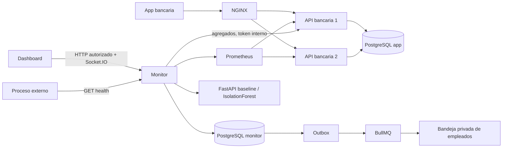

# Arquitectura objetivo y decisiones

Actualización: 18-10-2026. Evolución incremental, no reemplazo de los backends.

La app y el monitor conservan bases separadas. El monitor recibe agregados, no credenciales PostgreSQL de la app. La analítica usa una URL interna fija; no acepta destinos desde solicitudes. NGINX bloquea `/internal/` y `/metrics` públicamente.

Los eventos de métricas son efímeros: secuencia + snapshot recuperan pérdidas. Incidentes y notificaciones son persistentes. Un único backend del monitor publica eventos en esta versión; para réplicas del monitor falta distribución y coordinación de recolección. No introducir Kafka/Kubernetes para ocultar esa limitación.

El modelo no ejecuta comandos, no cambia saldos y no ordena failover. El control por ruta queda pendiente de un adaptador NGINX probado. No se añadieron botones de control sin implementación efectiva.
